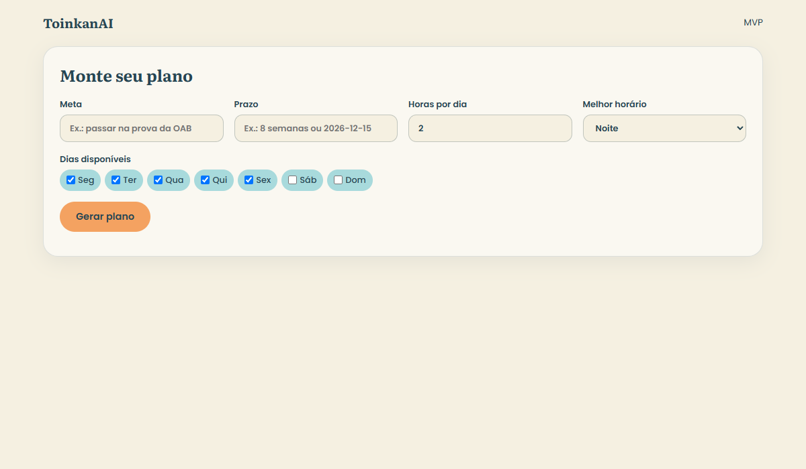
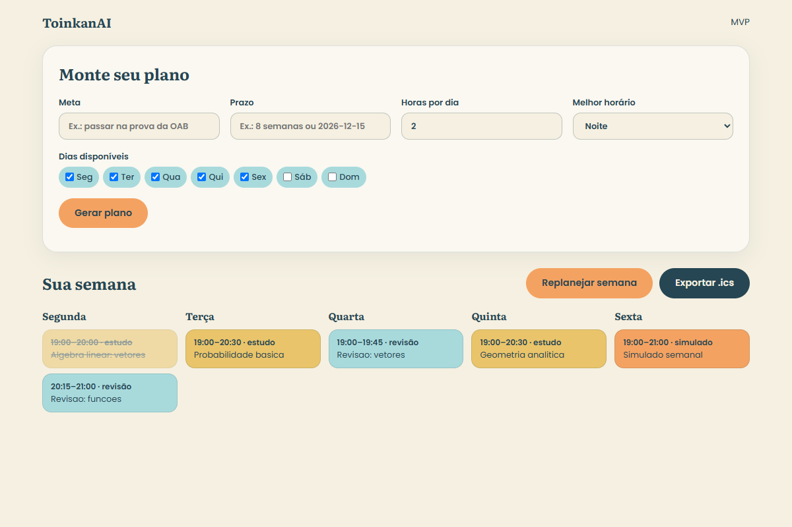

# ToinkanAI

[English](#english) · [Português](#português)

---

## English

A landing page plus a working MVP of an **AI study planner** (PT/EN). A small Node backend calls the Anthropic API (`claude-sonnet-4-6`) to build and re-balance weekly study plans. **The API key never reaches the browser.**

| Onboarding | Weekly plan |
| --- | --- |
|  |  |

> Screenshots of `/app`. The weekly view uses sample data; generating a real plan requires a valid `ANTHROPIC_API_KEY`.

### Features

- Onboarding form: goal, deadline, hours per day, available days, best time of day
- Weekly view in the landing's visual style (Literata + Poppins, `#F5F0E1 #F4A261 #E9C46A #A8DADC #264653`)
- Click a session to mark it as done
- "Replan week" button: redistributes the sessions you fell behind on
- Export to `.ics` (weekly recurrence, 4 weeks)

### Architecture

```
Browser (index.html, app.html)  --fetch-->  Express (server/index.js)
                                              ├─ limits.js  per-IP daily rate limit
                                              ├─ schema.js  zod (input and output)
                                              └─ claude.js  Anthropic SDK  -->  Claude
```

- `POST /api/plan` — `{meta, prazo, horas_por_dia, dias_disponiveis, melhor_horario}` → `{sessoes:[{dia,inicio,fim,topico,tipo}]}` where `tipo` is `estudo | revisão | simulado`
- `POST /api/replan` — `{plano, sessoes, concluidas:[indices]}` → new sessions for what was missed
- `/app` — the UI; state is kept in `localStorage`

### How Claude is used

1. The system prompt requires **JSON only**, in the session schema, with rules for days, time windows and session length.
2. User input is wrapped in `<dados>…</dados>` and treated as data, not instructions (prompt-injection mitigation).
3. Output is validated with zod. If invalid, the validation error is sent back to Claude to fix it (up to 2 retries).
4. For replanning, the server splits done vs. missed sessions and asks Claude to redistribute only the missed ones.
5. Cost: roughly US$0.02 per plan (estimate in `server/claude.js`; check current Anthropic pricing).

Limits: `DAILY_LIMIT_PER_IP` requests per IP per day (in-memory), `MAX_OUTPUT_TOKENS` per call, JSON body ≤ 20 KB.

### Run locally

```bash
npm install
cp .env.example .env   # set ANTHROPIC_API_KEY
npm start              # http://localhost:3000  (app at /app)
npm test
```

> The landing on GitHub Pages is static; `/app` and `/api` need the Node server hosted elsewhere (Render, Fly, etc.).

---

## Português

Landing page e MVP funcional de um **planner de estudos com IA** (PT/EN). Um backend Node pequeno chama a API da Anthropic (`claude-sonnet-4-6`) para montar e reequilibrar planos semanais. **A chave da API nunca vai para o navegador.**

| Onboarding | Plano semanal |
| --- | --- |
|  |  |

> Screenshots de `/app`. A semana usa dados de exemplo; gerar um plano real exige uma `ANTHROPIC_API_KEY` válida.

### Funcionalidades

- Formulário: meta, prazo, horas por dia, dias disponíveis, melhor horário
- Visualização semanal no visual da landing (Literata + Poppins e a paleta da marca)
- Clique na sessão para marcar como feita
- Botão "Replanejar semana": redistribui o que atrasou
- Exportar `.ics` (recorrência semanal, 4 semanas)

### Arquitetura

Veja o diagrama na seção em inglês. Rotas: `POST /api/plan`, `POST /api/replan` e a página `/app` (estado em `localStorage`).

### Como o Claude é usado

1. O system prompt exige **somente JSON** no formato das sessões, com regras de dias, horários e duração.
2. Os dados do usuário vão em `<dados>…</dados>` e são tratados como dados, não instruções.
3. A resposta é validada com zod; se inválida, o erro volta ao Claude para correção (até 2 retries).
4. No replan, o servidor separa sessões feitas e atrasadas e pede a redistribuição só das atrasadas.
5. Custo: ≈ US$0,02 por plano (ver comentário em `server/claude.js`).

Limites: `DAILY_LIMIT_PER_IP` requisições por IP por dia (em memória), `MAX_OUTPUT_TOKENS` por chamada, corpo JSON ≤ 20 KB.

### Rodar local

```bash
npm install
cp .env.example .env   # preencha ANTHROPIC_API_KEY
npm start              # http://localhost:3000  (app em /app)
npm test
```

> A landing no GitHub Pages é estática; `/app` e `/api` precisam do servidor Node hospedado em outro lugar.
